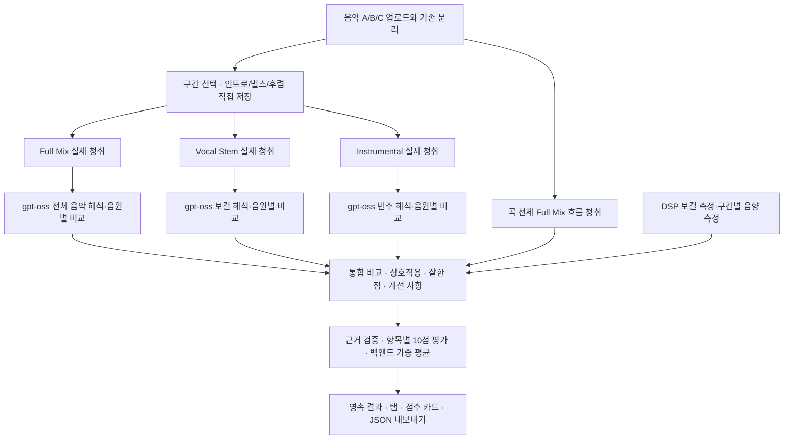

# 음악 전체 맥락 분석 · music-context-v2

## 처리 순서

Music Flamingo에는 요청당 실제 오디오 한 개를 보낸다. Full Mix는 원본 음악이며 Vocal은 기본 분리 보컬이다. Instrumental은 분리 결과의 비보컬 스템을 같은 샘플 위치에서 합산한다. 별도의 악기 모델이나 주파수 필터를 반주 분리로 표시하지 않는다. 현재 화면은 세 유형을 사용하며 Individual Stems의 별도 AI 분석 선택 UI는 포함하지 않는다.

gpt-oss 요청은 전체 음악, 보컬, 반주, 통합의 네 단계다. 각 유형은 음원별 해석/장점/아쉬운 점/개선 제안과 비교를 반환한다. 마지막 단계는 세 결과와 Full Mix 청취 근거를 함께 읽고 음악 전체에 미치는 영향과 개선 순서를 설명한다. 전문가 피드백은 아직 없으며 빈 목록을 유지한다.

## 시간과 맥락

- 구간은 수동 시작/끝 또는 이름을 저장한 구간으로 선택한다. 인트로·벌스·후렴 이름은 사용자 판단이며 자동 구조 검출 결과가 아니다.
- 전체 곡의 Full Mix 요약과 선택 구간의 상세 해석을 분리한다. 선택 구간이 곡 전체를 이미 포함하면 Full Mix 요청을 재사용하고, 아니면 전체 곡의 추가 청취를 수행한다. 긴 전체 곡도 모든 프레임을 포함한다.
- 기본 30초는 API 요청 상한이다. 저장한 구조 경계를 먼저 사용하며, 긴 구간은 상한 근처의 낮은 RMS 경계 후보로 나눈다. 이를 확정적인 음악 구조 경계로 부르지 않는다.
- 세 입력은 동일 Full Mix에서 만든 구간 계획과 group_id를 공유한다. 각 group_id에 세 유형과 같은 실제 시각이 있어야 추론한다.
- 변형 보컬은 속도/음정·시간축이 달라질 수 있어 이번 3종 통합 평가에서 보류한다. 기존 변형·DSP·재생은 유지한다. 원본/반주가 없는 이전 보컬 전용 프로젝트도 통합 분석을 위해 원본을 다시 업로드해야 한다.
- A/B/C 비교 오프셋은 수동 시간 정렬이다. 서로 다른 곡의 같은 시각이 동일한 음악 구간임을 보장하지 않는다.

WAV는 모노 24kHz PCM16으로 만든다. 스템 합산 등으로 진폭이 범위를 넘는 경우에만 PCM 클리핑을 피하기 위한 gain을 적용하고 pcm_gain과 변환 전 측정값을 기록한다. 원본 재생 음량을 변경하지 않는다.

## DSP와 청감 해석

기존 보컬 pYIN·RMS·온셋·비브라토 후보를 보존한다. 추가로 각 실제 오디오 요청 구간에 RMS/peak dBFS, 다이내믹 범위, 스펙트럼 중심, 온셋 후보, 에너지 주기 기반 템포 후보를 계산한다. 다성 Full Mix에 보컬용 단일 F0를 적용하지 않는다. 템포와 비브라토는 후보이며, 음 중심 편차를 악보 대비 정확도로 취급하지 않는다.

Flamingo의 감정선·창법·성구·긴장감·음색 평가는 청감상 해석으로 다룬다. 확정적 창법, 의도, 감정 판정은 요구하지 않는다. 모델 원문이 JSON을 따르지 않으면 원문을 보존하고 structured=false 및 구조 추출 한계를 기록한다. 빈 특징 필드를 성공적인 특성 추출로 표시하지 않는다.

상호작용은 해당 선택 구간의 Full Mix 청취 ID를 반드시 인용해야 한다. 반주나 보컬 단독 결과만으로 조화·그루브 관계를 확정하지 않는다. 전체 곡 요약에는 provides_song_overview=true인 근거가 필요하다. 없는 ID, 다른 음원의 ID, 구간 평가에서 전체 곡의 다른 구간 ID를 쓰는 경우 보고서 생성을 실패 처리한다. 인용의 존재를 검증하는 것이 해석의 음악적 정확도까지 보증하지는 않는다.

## 10점 평가 · music-context-10-v1

| 항목 | 비중 | 필요한 근거 |
| --- | ---: | --- |
| 보컬과 음악의 조화 | 25% | 선택 구간 Full Mix |
| 목소리와 편곡의 어울림 | 15% | Full Mix + Vocal |
| 창법과 표현 제어 | 20% | Vocal |
| 기본기와 리듬·프레이징 | 20% | Vocal + 기존 보컬 DSP |
| 음색의 일관성과 활용 | 10% | Vocal |
| 감정선·다이내믹 표현 | 10% | Full Mix + Vocal |

각 점수는 0~10의 주관적 AI 추정이며 근거 ID, 이유, confidence와 uncertainty를 갖는다. 기준은 0~2점: 관찰 가능한 제어/조화가 약함, 3~4점: 잦은 불균일, 5~6점: 기능하지만 편차가 있음, 7~8점: 일관되고 맥락에 어울림, 9~10점: 선택 구간 전체에서 설득력 있게 표현됨이다. 음원·믹스·분리 품질과 모델 편향에 영향을 받으며 가수의 보편적 실력이나 검증된 정확도를 나타내지 않는다.

종합 점수는 LLM이 만든 임의의 숫자를 받아 표시하지 않는다. 백엔드가 여섯 항목의 고정 가중 평균을 소수 첫째 자리까지 반올림한다. 근거가 부족한 항목은 null/판단 보류이며 0점이 아니다. 하나라도 판단을 보류하면 종합 점수도 보류하고 coverage를 별도로 기록한다. 기본기 항목은 최소한 사용 가능한 보컬 DSP가 있어야 하며 유효 음정 프레임이 3개 미만이면 판단 보류하도록 한다. 충분한 프레임 수 자체가 정확도나 좋은 점수를 보증하지 않는다.

0~10 범위 이탈, NaN, boolean 점수, 누락된 평가 항목, 출처가 다른 근거, Full Mix 없는 상호작용은 성공 결과로 저장하지 않는다. 원격 모델의 스키마 준수 여부가 실제로 검증되지 않았다면 동작을 확인한 것으로 표시하지 않는다.

## 저장과 실패 처리

기존 report_jobs/MongoDB 또는 로컬 jobs JSON에 원문과 전체 결과를 저장하고 프로젝트에는 화면·이력용 요약을 둔다. 저장된 리포트를 열면 작업의 전체 결과를 다시 가져온다. 다음 항목을 함께 저장한다.

- 유형, source_id/track_id, scope, 구조 구간 이름, group_id/evidence_id.
- 원본 프레임/시각, WAV 해시, 오디오 형식, PCM gain, 구간 DSP 측정.
- Flamingo 원문·모델/응답 ID·사용량, 음악적 특징, 관련 근거, 불확실성.
- 세 gpt-oss 개별 결과와 원문, 통합 비교/전체 곡 요약/구간 상호작용, 개선 사항.
- 항목별 점수/근거/불확실성, 평가 기준 버전, 백엔드 종합 점수와 coverage.

청취와 LLM 단계마다 중간 응답을 영속 저장한다. 통합 결과 검증 실패 시 성공 보고서를 만들지 않으며 GET /api/jobs/{id}의 partial_audio_analyses/partial_llm_analyses로 완료된 중간 자료를 확인할 수 있다. 키와 Base64 오디오는 저장하지 않는다. UI 탭과 점수 카드는 결과를 다시 가져와도 동일한 저장 결과를 표시한다.

## 로컬 검증과 원격 서버 진단

로컬에서 합성 오디오의 스템 합산·프레임 정렬·구간 경계·DSP·API payload·4단계 추론·스키마·채점·저장을 검증한다. 자동 테스트의 AI 응답은 모의 응답이며 실제 음악 품질 검증은 아니다. 기존 분리·재생·변형·비교·인증도 회귀 검사한다.

원격 GPU 서버 내부는 이 변경에서 검사하지 않았다. 다음은 별도 진단 항목이다.

1. 각 URL의 `/v1/models`에 `.env` 모델 ID가 실제로 있는지 확인한다.
2. Music Flamingo의 모델 구현과 chat template이 단일 `input_audio` Base64 WAV를 실제 처리하는지 짧은 음악으로 확인한다.
3. gpt-oss가 네 단계의 JSON 지시를 따르고 충분한 출력 토큰 안에 필수 필드를 반환하는지 실제 3종 분석에서 확인한다. 강제 response_format 같은 미검증 서버 기능은 요청하지 않는다.
4. 요청 길이·멀티모달 context·출력 토큰 제한과 GPU 메모리/동시성은 원격 서버 설정에서 확인한다.
5. 분리 누설·창법/감정 해석·항목 점수와 신뢰도는 실제 음악과 전문가 평가로 별도 검증/보정한다.

`python -m backend.check_ai --audio sample.wav`는 짧은 Full Mix와 LLM 텍스트 연결 진단이다. 실제 3종 추론·채점 검증으로 표시하지 않으며 three_way_pipeline_verified=false를 명시한다. 기존 AUDIO_AI_*/LLM_AI_* 환경변수는 유지한다. 관리자 검토 시스템, 실제 학습/파인튜닝, 자동 음악 구조 분류와 개별 악기 AI 선택 UI는 다음 단계다.
